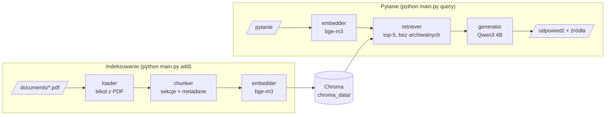

# Asystent RAG dla polityk firmy Northstar Services

Lokalny system RAG, który odpowiada na pytania pracowników na podstawie dokumentów z `documents/`. Podaje krótką odpowiedź ze źródłem (plik i sekcja), odmawia, gdy w dokumentach nie ma odpowiedzi, i pomija dokumenty archiwalne. Wszystko działa lokalnie: Ollama (Qwen3 4B, bge-m3) i Chroma, bez płatnych API i bez LangChaina.

## Uruchomienie

Pracowałem na Windows 11 z Pythonem 3.12 i [Ollamą](https://ollama.com).

```bash
python -m venv .venv
.venv\Scripts\activate
pip install -r requirements.txt
ollama pull qwen3:4b
ollama pull bge-m3
```

```bash
python main.py add       # wczytanie PDF-ów, podział na chunki, embeddingi, zapis do ./chroma_data
python main.py query "Ile dni w tygodniu można standardowo pracować zdalnie?"
python main.py reset     # usunięcie kolekcji
python -m eval.run_eval  # ewaluacja na 22 pytaniach -> eval/results.md
pytest                   # testy kodu, bez Ollamy
```

Przykładowy wynik `query`:

```
3 dni w tygodniu.

Źródła: 01_praca_zdalna_v2.pdf (Zasady ogólne)

Fragmenty przekazane do modelu (top-5):
  1. [score 0.754] 01_praca_zdalna_v2.pdf::0 (Zasady ogólne)
     Pracownik może wykonywać pracę zdalną maksymalnie 3 dni w tygodniu, o ile charakter stanowiska na to...
  2. [score 0.667] 01_praca_zdalna_v2.pdf::1 (Praca zdalna z zagranicy)
  ...

Czas: wyszukiwanie 0.1 s, odpowiedź modelu 12.1 s
```

Pod odpowiedzią są fragmenty, które dostał model, z ID chunku w Chroma i podobieństwem do pytania. Model LLM można zmienić zmienną `LLM_MODEL`, a adres Ollamy zmienną `OLLAMA_HOST`; pozostałe parametry są w `src/config.py`.

**Notebook** `notebooks/rag_krok_po_kroku.ipynb` pokazuje każdy etap na prawdziwych danych: tekst z PDF, chunki, wektory, Chromę, wyszukiwanie z filtrem archiwum i bez, prompt i surową odpowiedź modelu (`pip install -r requirements-dev.txt`, potem `jupyter notebook`).

**Docker.** Obraz zawiera kod, zależności i dokumenty, a przy budowaniu uruchamia testy. Ollama zostaje na hoście (kontener łączy się z nią przez `host.docker.internal`), więc GPU, jeśli jest, wykorzystuje sama Ollama.

```bash
docker build -t rag-northstar .
docker run --rm -v rag-index:/app/chroma_data rag-northstar add
docker run --rm -v rag-index:/app/chroma_data rag-northstar query "Ile dni w tygodniu można standardowo pracować zdalnie?"
```

Wyniki w kontenerze są takie same jak bez Dockera. Docker Desktop rezerwuje jednak pamięć na swoją maszynę wirtualną: na laptopie z 16 GB RAM przy otwartej przeglądarce Ollamie zabrakło pamięci na model.

## Architektura



| plik | rola |
|---|---|
| `main.py` | CLI: `add`, `query`, `reset` |
| `src/loader.py` | tekst z PDF-ów (pypdf) |
| `src/chunker.py` | podział na sekcje, status dokumentu i flaga `archived` |
| `src/embedder.py` | embeddingi bge-m3 przez Ollamę |
| `src/datastore.py` | kolekcja Chroma (cosine), `upsert` po ID `plik::nr` |
| `src/retriever.py` | top-5 z filtrem `archived = False` |
| `src/generator.py` | prompt, odpowiedź Qwen3, odmowa bez źródeł |
| `src/config.py` | modele, ścieżki, parametry |
| `eval/` | pytania testowe, skrypt ewaluacji, wyniki |
| `tests/` | testy części deterministycznych (chunking, loader, filtr archiwum, obróbka odpowiedzi) |

## Dokumenty i konsekwencje ich struktury

Dostarczone dokumenty są bardzo jednolite i pipeline jest do nich dopasowany. Każdy to jednostronicowy PDF z warstwą tekstową, z tytułem, linią `Status: AKTUALNY | Wersja: … | Obowiązuje od: …` i kilkoma sekcjami z krótkimi nagłówkami. Z tego wynika:

- **Format:** czytane są tylko PDF-y z warstwą tekstową. Inne pliki (`.txt`, `.md`, `.docx`) i skany są pomijane, nie ma OCR.
- **Sekcje:** nagłówek to krótka linia (do 60 znaków) bez kropki na końcu, która następuje po zakończonym zdaniu. Przy innym układzie podział się psuje: nagłówki typu „1. Zakres.” nie zostaną rozpoznane i cały dokument będzie jednym chunkiem, a w wielostronicowym PDF-ie stopka strony zostałaby uznana za nagłówek. Sekcja jest zawsze jednym chunkiem, więc długie sekcje dałyby za długie chunki (tu mają 80–290 znaków).
- **Aktualność:** status jest czytany z linii `Status:` albo z `ARCHIW` w nazwie pliku. Dokument bez takiego oznaczenia jest traktowany jako aktualny.

Dla innych dokumentów trzeba by dodać obsługę innych formatów (i OCR), dzielić tekst po długości albo po nagłówkach z metadanych pliku i ustalać aktualność np. po dacie „Obowiązuje od”.

## Decyzje projektowe

**Chunking po sekcjach.** Jeden chunk to jedna sekcja z doklejonym „tytuł dokumentu – sekcja”, więc fragment jest zrozumiały sam w sobie, a źródło można podać z sekcją. Przy chunkach po ok. 1000 znaków każdy dokument był jednym chunkiem i embedding mieszał kilka tematów. Po zmianie właściwy plik jest na 1. miejscu w 18/18 pytań (wcześniej 16/18). Stron nie podaję, bo każdy dokument ma jedną.

**Embeddingi: bge-m3.** Model wielojęzyczny, dobrze radzi sobie z polskim i łączy parafrazy („praca z domu” i „praca zdalna”). Jest mały (1,2 GB), na licencji MIT i dostępny w Ollamie. Sprawdziłem też `qwen3-embedding:4b`: trafność była taka sama, a indeksowanie 4× wolniejsze.

**Chroma.** Lokalna baza zapisywana na dysku, bez osobnego serwera. Embeddingi liczę sam i przekazuję jawnie. Przy 37 chunkach samo wyszukiwanie wektorowe wystarcza.

**Dokumenty archiwalne.** Flaga `archived` jest w metadanych każdego chunku, a retriever zawsze filtruje `archived = False`. Bez filtra embedding nie odróżnia wersji: przy pytaniu o termin rozliczenia delegacji archiwalna sekcja (14 dni) była wyżej niż aktualna (10 dni).

**Brak informacji.** Prompt każe odpowiadać tylko z kontekstu, a gdy odpowiedzi nie ma, zwrócić stałe zdanie „Nie wiem – w dostępnych dokumentach nie ma tej informacji.”. Model czasem dopisywał do odmowy źródła, więc kod w takim przypadku zwraca samo zdanie odmowy. Progu na podobieństwie nie użyłem, bo pytania bez odpowiedzi są bardzo podobne do dokumentów o tym samym temacie (np. „ile dni urlopu przysługuje” i dokument o urlopach).

**LLM: Qwen3 4B.** Model rekomendowany w zadaniu, dobrze radzi sobie z polskim. Tag `qwen3:4b` to wariant Thinking: zawsze najpierw rozumuje (ok. 500–1300 tokenów), więc kod zostawia tylko tekst po `</think>`. Czasem zapętla się w rozumowaniu, dlatego `NUM_PREDICT = 3000` ucina generowanie. Sprawdziłem też wariant bez rozumowania (`qwen3:4b-instruct`): jest ok. 5× szybszy, ale odmówił przy pytaniu o budżet na szkolenia, bo w dokumencie jest „budżet rozwojowy”, a tego powiązania nie zrobił. Wybrałem trafność zamiast szybkości.

**Temperatura 0.2 i `SEED = 42`.** Przy temperaturze 0.6 (zalecanej dla trybu myślenia) model częściej dopisywał źródła do odmowy, a 0 odpada, bo Qwen ostrzega przed zapętleniami. Stałe ziarno daje zwykle tę samą odpowiedź na tym samym sprzęcie, ale nie pełny determinizm: na CPU i GPU obliczenia różnią się zaokrągleniami i model może pójść inną ścieżką (pytanie 16 w ewaluacji).

### Sprzęt

Potrzeba ok. 8 GB RAM (qwen3:4b ok. 4 GB, bge-m3 ok. 1,2 GB), karta graficzna nie jest wymagana. Jeśli jest GPU NVIDIA, Ollama używa go sama. Ten sam kod uruchomiłem na dwóch laptopach:

| | CPU | GPU |
|---|---|---|
| sprzęt | Intel i7-1370P, 32 GB RAM | Ryzen 7 7735HS, 16 GB RAM, RTX 4060 Laptop 8 GB |
| generowanie | ok. 11 tokenów/s | ok. 75 tokenów/s |
| czas na pytanie (średnio) | 65 s | 11 s |
| cała ewaluacja (22 pytania) | 24 min | 4 min |

Lżejszy wariant: `ollama pull qwen3:4b-instruct` i `LLM_MODEL=qwen3:4b-instruct` (bez rozumowania, dużo szybszy, trochę słabszy, patrz wyżej).

## Ewaluacja

`eval/questions.json` ma 22 pytania:
- 13 z odpowiedzią w jednym dokumencie,
- 2 o polityce podróży, która ma też wersję archiwalną,
- 3 wymagające dwóch dokumentów,
- 4 bez odpowiedzi w dokumentach.

Każde pytanie ma oczekiwane pliki źródłowe i wzorce (regex), które odpowiedź musi zawierać (`must`) albo nie może (`must_not`, np. archiwalne 500 PLN). `python -m eval.run_eval` sprawdza dla każdego pytania:
- **wyszukiwanie:** czy oczekiwane pliki są w top-5, czyli w prompcie,
- **odpowiedź:** czy zawiera wymagane fakty i nie zawiera nieaktualnych; przy pytaniach bez odpowiedzi, czy jest odmową,
- **źródła:** czy cytuje oczekiwane pliki; przy pytaniach bez odpowiedzi, czy nie cytuje żadnego.

Pole `expected_answer` jest tylko dla człowieka czytającego raport.

| przebieg | wyszukiwanie | odpowiedź | źródła |
|---|---|---|---|
| CPU ([`eval/results.md`](eval/results.md)) | 18/18 | 22/22 | 22/22 |
| GPU ([`eval/results_gpu.md`](eval/results_gpu.md)) | 18/18 | 22/22 | 21/22* |

\* Pytanie 16: odpowiedź poprawna, ale cytuje tylko `11_polityka_AI.pdf`, bez `05_klasyfikacja_danych.pdf`.

Wnioski:
- Wyszukiwanie działa: właściwy plik jest na 1. miejscu w 18/18 pytań.
- Odpowiedzi o podróże podają aktualne 800 PLN i 10 dni, nigdy archiwalnych wartości.
- Wszystkie 4 pytania bez odpowiedzi kończą się odmową bez źródeł.
- Najsłabszy jest model: przy pytaniach z dwóch dokumentów zdarza mu się zacytować jedno źródło, a na CPU zdarzało mu się zapętlić do limitu tokenów.

Zestaw jest mały i napisany przeze mnie, znając dokumenty, więc wynik jest raczej optymistyczny (jedno pytanie to ok. 5 punktów procentowych). Wzorce sprawdzają kluczowe fakty, a nie jakość sformułowania.

`pytest` to osobna rzecz: 7 szybkich testów kodu bez Ollamy (odpowiedź modelu jest podstawiona).

## Ograniczenia i możliwe rozszerzenia

- Pipeline jest dopasowany do struktury tych dokumentów (patrz wyżej).
- Pytania o dawne zasady („jaki był limit wcześniej?”) nie dostaną odpowiedzi, bo archiwum jest zawsze odfiltrowane.
- Na CPU odpowiedź trwa ok. 1–2 min, głównie przez rozumowanie modelu.
- Ocena opiera się na wzorcach i małym zestawie pytań; przy większym zbiorze warto dodać pytania od użytkowników i ocenę ręczną albo przez LLM.
- Przy większej liczbie dokumentów: wyszukiwanie hybrydowe (BM25 + wektory) i reranking.
